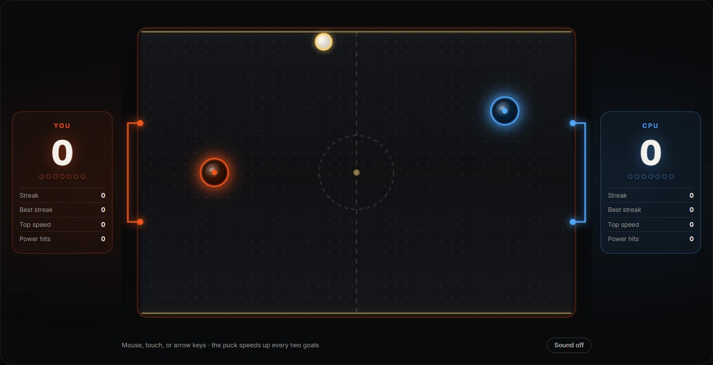

# Air Hockey



Air hockey against a CPU in the browser, first to seven. Canvas physics, a puck that gets quicker every two goals, and slow motion when either side reaches game point.

## What's in it

- **The table:** a 2D canvas drawn at 760×520 and scaled to fit, with glowing goals, a puck trail, particles and a goal flash.
- **Physics:** circle collisions with restitution, friction and wall bounce, on a fixed 60 Hz step. The puck moves at the same speed on a 60 Hz laptop and a 144 Hz monitor, and a slow frame catches up rather than slowing the game.
- **The CPU:** it predicts where the puck will cross its half and heads there, retreats when cornered, and now and then misjudges on purpose so it can be beaten.
- **Pacing:** the puck speeds up every two goals, and game point drops the table into slow motion.
- **Sound:** hits, walls, goals and a victory fanfare, synthesised with the Web Audio API and off until you switch it on.

## Controls

Move your mallet with the mouse, a finger, or the arrow keys / WASD once the table has focus. Press **Start match** to play.

## Good manners on a page

- Input is scoped to the table, and the cursor only hides over it during play.
- The game loop stops while the table is scrolled out of view or the tab is hidden.
- After a win, confetti falls for a few bursts and stops.
- With reduced motion on (the system setting, or `data-motion="paused"` on `<html>` from a host page), there's no screen shake or confetti.
- The table is announced to screen readers as an application, with the score in its label and changes read out.

## Use it in another React app

The repo doubles as a package, which is how the portfolio site runs it. Install it from GitHub at a version tag:

```bash
npm install github:Dekrayzis/air-hockey#v1.0.2
```

Then import the component and its stylesheet (the app needs Sass):

```tsx
import { AirHockey } from "air-hockey";
import "air-hockey/styles.scss";

<AirHockey />;
```

It ships as TypeScript source, so a Next.js app lists it in `transpilePackages` in `next.config.ts`. React 19 is a peer dependency. The stylesheet reads a host page's design tokens when they exist (`--c-accent`, `--sp-2` and so on), so it picks up that page's accent colour, and falls back to its own values otherwise.

## How the code is laid out

| File | What it holds |
| --- | --- |
| `src/air-hockey/AirHockey.tsx` | The component: scoreboard, start and game-over screens, sound switch |
| `src/air-hockey/engine.ts` | The match: the game's state, kick-off to the winning goal, and how the parts fit together |
| `src/air-hockey/physics.ts` | The puck, the rails and the mallet hits; reports what happened as events |
| `src/air-hockey/cpu.ts` | The CPU's decisions and movement |
| `src/air-hockey/input.ts` | Your mallet's controls: pointer, touch and keys |
| `src/air-hockey/render.ts` | All the drawing, with the table cached off-screen |
| `src/air-hockey/effects.ts` | Particles, sparks, confetti and screen shake |
| `src/air-hockey/sound.ts` | The synthesised sound effects |
| `src/air-hockey/loop.ts` | A fixed 60 Hz loop that pauses off screen and in hidden tabs |
| `src/air-hockey/colour.ts` | Colour helpers, and reading the palette from the page |
| `src/air-hockey/constants.ts` | Everything that tunes the game: the table, physics, the CPU, timings |
| `src/air-hockey/types.ts` | The shapes the files share, including the game's state (World) |
| `src/air-hockey/motion.ts` | The reduced-motion check |
| `src/sections/_air-hockey.scss` | The component's styles and palette |
| `src/abstracts/_index.scss` | The design tokens and helpers, with fallbacks |

## Run it

```bash
npm install
npm run dev
```

`npm run build` makes a static build in `dist/`.

Built with React, TypeScript, Sass and Vite.

## Author

Vincent Corleone.
